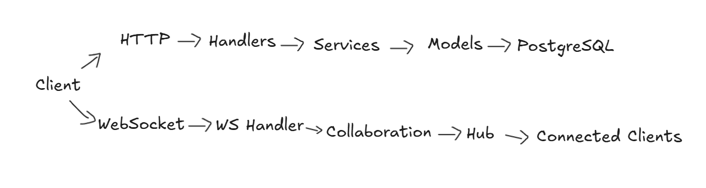

# Real-Time Collaborative Document Editor

A backend for collaborative document editing built with Go and PostgreSQL. Users can create documents, share them with other users, edit them based on their roles, and collaborate through WebSockets. The system also maintains document history and supports restoring previous versions.

## Features
- JWT-based user authentication
- Document CRUD operations
- Role-based access control
    - Owner
    - Admin
    - Editor
    - Viewer
- Invite users to documents and accept invitations
- Real-time document editing using WebSockets
- WebSocket authentication and document access checks
- Document version history & Restore previous versions without removing existing history
- Optimistic concurrency control using document versions
- Atomic document and version updates using database transactions
- Dashboard API

## Tech Stack
- Language: **Go**
- HTTP Router: **Chi**
- Database: **PostgreSQL**
- ORM: **GORM**
- Authentication: **JWT**
- Real-Time Communication: **WebSockets**
- Database Migrations: **Atlas**
- Containerization: **Docker**

## Architecture
The backend is organized into handlers, services, models, entities, middleware, and collaboration components.

## Document Access
Documents use role-based access control. Access is checked before protected document operations and before establishing a WebSocket connection.

## Real-Time Collaboration
Clients connect to a document through WebSockets. The server authenticates the JWT, verifies document access, and then establishes the connection.

Each WebSocket client uses a read pump and write pump, while a Hub manages connected clients and broadcasts document updates.

Edits include a base document version. If a client submits an edit based on an outdated version, the server rejects it instead of overwriting a newer document state.

The current implementation uses optimistic concurrency control rather than Operational Transformation (OT) or CRDTs.

## Versioning and Concurrency
Every document starts at version 1. Updates create new versions, preserving previous document states. Restoring an older version creates a new version instead of deleting or modifying existing history.
- v1 → Initial document
- v2 → Edit
- v3 → Edit
- v4 → Restore v2

Document updates and version creation are handled in the same database transaction so they either both succeed or both roll back.

## Invitations & Permissions
Document owners/admins can invite users by email. Accepted invitations create document membership with the assigned role. Access checks are applied to document operations and WebSocket connections.

## Dashboard
The dashboard provides a single endpoint for the main document-related information a user needs after login.

GET /dashboard - It returns:
- Documents owned by the user
- Recently updated accessible documents
- Documents shared with the user
- Pending document invitations

## API

| Area | Endpoints |
| --- | --- |
| Authentication | Register, Login |
| Documents | Create, Get, Update, Delete |
| Members | Add, List, Update Role, Remove |
| Invitations | Create, Accept, Get |
| Versions | History, Get, Restore |
| Dashboard | Get Dashboard |
| Collaboration | WebSocket |

## Running Locally
### Prerequisites
- Go
- PostgreSQL
- Docker
- Atlas

### Configuration
Create a .env file with the required database and JWT configuration, then run the database migrations and start the application.

Do not commit .env or other secrets to the repository.

Run the database migrations using the project's Atlas configuration before starting the application.

## Current Scope

The current version focuses on the backend: authentication, document management, permissions, invitations, versioning, concurrency control, dashboard APIs, and WebSocket-based collaboration.

The frontend, Redis-based distributed collaboration, notifications, cursor synchronization, and OT/CRDT conflict resolution are planned as future improvements.